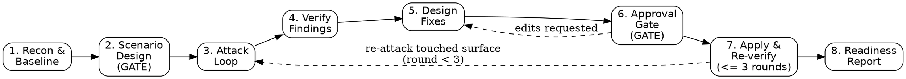

# kryptonite

Superpowers *builds* systems. `kryptonite` *breaks them, then hardens them* —
without regressing what already works. Use it on a working app (any stack:
web, API, mobile, CLI, library) when the goal is to find out what actually
fails under real-world conditions and fix it before it ships: "harden this,"
"break this," "attack this," "red-team this," "stress-test this," "make this
production-ready."

This is not a one-shot scanner. It is an 8-phase loop that captures what the
app does right today (the feature baseline), attacks it on purpose, verifies
every claim adversarially, proposes minimal fixes with tests, waits for your
approval, applies and re-verifies, and ends with a GO/NO-GO call.

## The 8-Phase Attack-and-Harden Loop

Each node is a phase skill directory:

| Phase | Skill |
|-------|-------|
| 1 | `phases/1-recon-and-baseline/SKILL.md` |
| 2 | `phases/2-scenario-design/SKILL.md` |
| 3 | `phases/3-attack-loop/SKILL.md` |
| 4 | `phases/4-verify-findings/SKILL.md` |
| 5 | `phases/5-design-fixes/SKILL.md` |
| 6 | `phases/6-approval-gate/SKILL.md` |
| 7 | `phases/7-apply-and-reverify/SKILL.md` |
| 8 | `phases/8-readiness-report/SKILL.md` |

## How to Run

1. **Start at Phase 1.** Load and follow `phases/1-recon-and-baseline/SKILL.md`
   first, always — it detects the app's stack, maps its surfaces, and
   captures the feature baseline every later phase must protect. Do not skip
   ahead even if you think you already know the app.
2. **Phase 1 hands off to Phase 2.** Recon output (surface map + baseline
   suite) becomes the input to `phases/2-scenario-design/SKILL.md`, which
   selects applicable attack modules from `modules/` and drafts concrete
   scenarios. This phase ends in a **gate**: present the attack plan and get
   the user's go-ahead before any attack executes.
3. **Phase 2 hands off to Phase 3.** Approved scenarios drive
   `phases/3-attack-loop/SKILL.md`, which dispatches attacker subagents
   (prompts in `references/agent-prompts.md`) to produce schema-valid
   candidate Findings (`references/finding-schema.md`), validated by
   `scripts/validate_findings.py`.
4. **Phase 3 hands off to Phase 4.** `phases/4-verify-findings/SKILL.md`
   reproduces every candidate adversarially, dedupes, and ranks by
   severity × exploitability (`references/severity.md`), setting each
   Finding's `status`.
5. **Phase 4 hands off to Phase 5.** For every `confirmed` Finding,
   `phases/5-design-fixes/SKILL.md` produces a minimal diff plus two tests
   (vulnerability closed + feature intact) — nothing is applied yet.
6. **Phase 5 hands off to Phase 6.** `phases/6-approval-gate/SKILL.md`
   presents each proposed diff, its tests, and its risk to the user, and
   records an explicit approve / reject / edit decision per finding. This is
   the last checkpoint before the working tree changes.
7. **Phase 6 hands off to Phase 7.** `phases/7-apply-and-reverify/SKILL.md`
   applies only approved fixes, re-runs the full feature baseline (any
   regression blocks the round), and re-attacks the touched surface. It loops
   back to Phase 3 for the touched surface up to the harden-round cap, then
   proceeds.
8. **Phase 7 hands off to Phase 8.** `phases/8-readiness-report/SKILL.md`
   emits the final GO/NO-GO verdict using `references/readiness-report.md`,
   summarizing attacked surfaces, findings by priority, fixes applied, and
   residual risk.

## Core Rules

These rules are non-negotiable and apply across every phase. Each phase skill
restates and enforces the rules relevant to it, but the source of truth is
here.

- **PROPOSE-THEN-APPROVE.** kryptonite never modifies the target app's
  working tree without explicit user approval. Phases 1–5 only observe,
  attack, and design — no fix is applied. Phase 6 is the single gate where
  the user approves, rejects, or edits each proposed fix. Phase 7 applies
  only what was approved there.
- **FEATURE-BASELINE GUARDRAIL.** Phase 1 captures what the app already does
  correctly — as a characterization/regression test suite (via
  `webapp-testing` / `run`) — before any attack begins. Every fix designed in
  Phase 5 and applied in Phase 7 must keep that baseline green; Phase 7
  re-runs the full baseline after every apply and treats any failure as a
  block on that round, not a finding to report later.
- **SUBAGENTS-ONLY, LOCAL-OR-TEST ENV.** All recon, attack, verification, and
  fix work is dispatched to subagents operating against a local or test
  instance of the target app. kryptonite never touches live infrastructure,
  production data, or production traffic — if only a production environment
  is available, phases fall back to static analysis and code-level probes
  instead of live attacks.
- **HARDEN-ROUND CAP = 3.** Phase 7's apply-reverify-reattack loop runs at
  most 3 rounds. If P0/P1 findings remain open after round 3, the loop stops
  and Phase 8 reports them as residual risk requiring explicit user
  risk-acceptance — kryptonite does not loop indefinitely chasing a fully
  clean result.
- **DISPATCH SUBAGENTS DIRECTLY BY DEFAULT.** Each phase dispatches its
  attacker/verifier/fixer subagents directly (per `references/agent-prompts.md`).
  Escalate to a Workflow tool script only for large runs — many modules,
  many surfaces, or many findings in flight at once — where a script-driven
  loop materially reduces coordination overhead; for a typical run, direct
  dispatch is simpler and sufficient.

## Attack Modules

The attack catalog lives in `modules/` and is intentionally extensible: each
attack dimension is one `.md` file (security penetration, API abuse and
limits, load and chaos resilience, data/logic integrity, config, observability,
failure UX, supply chain, privacy, cost, accessibility, and any dimension
added later). Phase 2 selects which modules apply to the target app's surface
map. To add a new dimension, drop a new `.md` file into `modules/` — no other
phase file needs to change.
